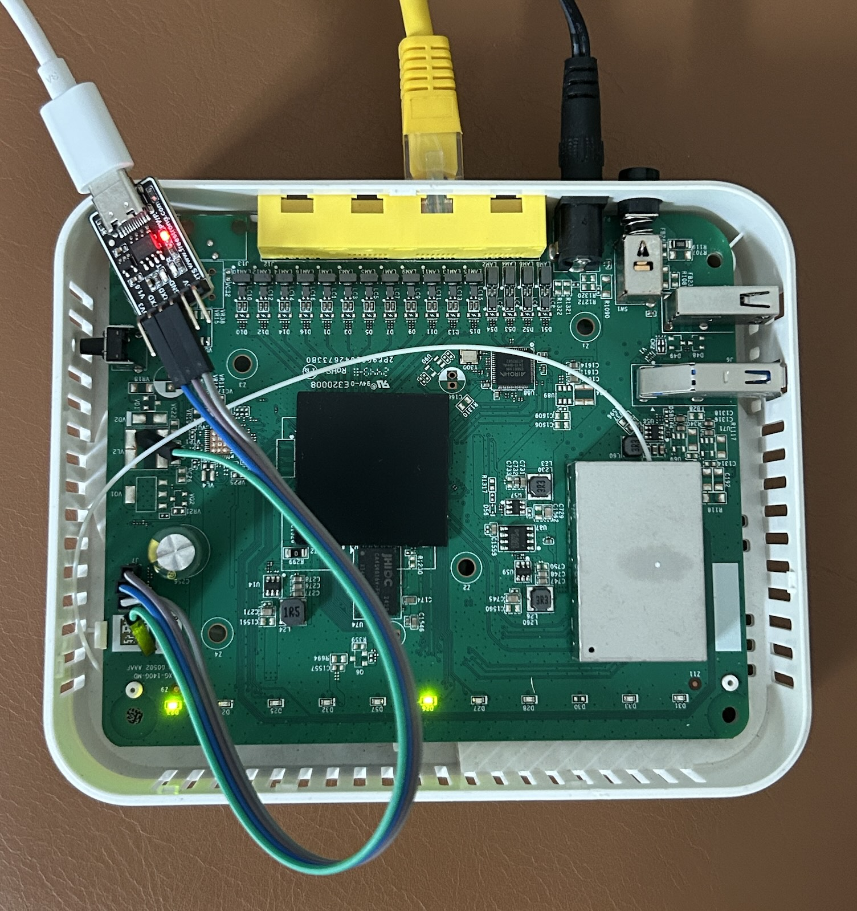
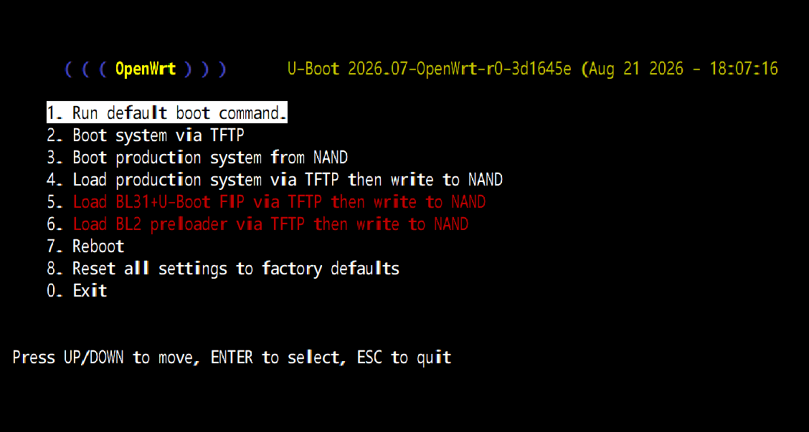
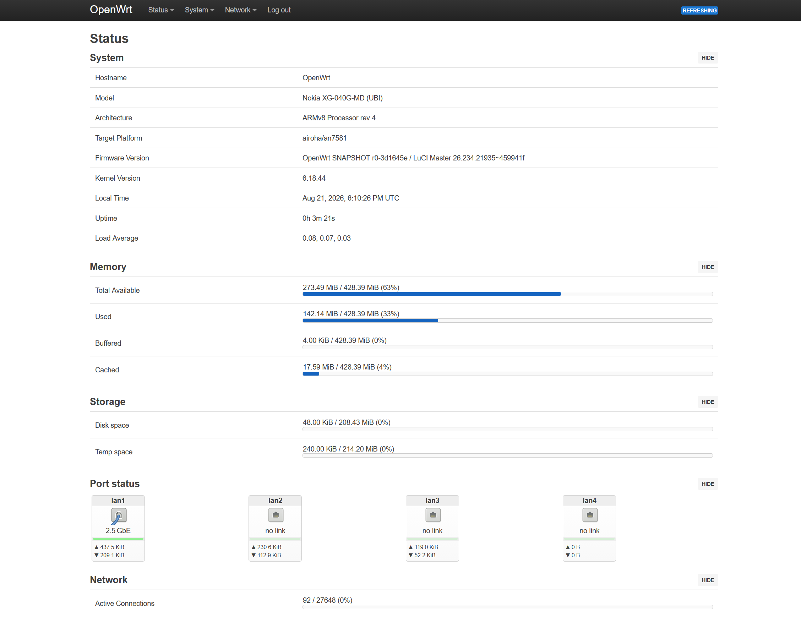

# OpenWrt for XG-040G-MD

OpenWrt firmware for NOKIA BELL XG-040G-MD

编译脚本基于 [Actions-OpenWrt](https://github.com/xuxin1955/Actions-OpenWrt) 修改。

* 固件使用 OpenWrt main 分支构建，包含 luci，不包含中文语言包及其他不必要的包，与其他常见的官方 image 类似，尽可能保持小体积。


## 关于 NAND Flash

XG-040G-MD 使用的 NAND Flash 主要有两个型号：
* SkyHigh S35ML02G300
* Fudan Micro FM25G02B: 晚期生产的，用此型号的较多。

> OpenWRT 对两者的支持程度有差异。如果使用时遇到 NAND 相关问题，请先确认 NAND Flash 型号，再排查问题。
> 最新的 main 分支已支持 NOKIA BELL XG-040G-MD，但是 **U-Boot 还不支持 Fudan Micro FM25G02B**。**操作不当很容易变砖**。

## 更新记录

* 2026-08-22: U-Boot 加入 Fudan Micro FM25G02B 补丁，现已支持 UBI Layout。

## 刷机方法

* 刷机方法见 [airoha: add support for Nokia XG-040G-MD](https://github.com/openwrt/openwrt/commit/a6ecb09985fa7c14bae1c1bad7d42495737bc0ba) , 参考 **Installation / recovery (OpenWrt U-Boot layout)**。
* main 分支变化频繁，固件刷入后，有一定几率无法成功启动。
* **请准备好 USB-TTL，做好随时救砖的准备**。这个机器可玩性还可以，准备好`preloader.bin、bl31-uboot.fip`，变砖了，恢复也方便，除非 Flash 有大量坏块。

## 刷机或效果

### USB-TTL



### U-Boot with Fudan Micro FM25G02B patch



```
U-Boot 2026.07-OpenWrt-r0-3d1645e (Aug 21 2026 - 18:07:16 +0000)

CPU:   Airoha AN7581
DRAM:  512 MiB
Core:  37 devices, 22 uclasses, devicetree: separate
Loading Environment from UBI... spi-nand: spi_nand nand@0: Fudan Micro SPI NAND was found.
spi-nand: spi_nand nand@0: 256 MiB, block size: 128 KiB, page size: 2048, OOB size: 128
Read 126976 bytes from volume ubootenv to 000000009fadf7c0
Read 126976 bytes from volume ubootenv2 to 000000009fafe80
```

### Flash Layout

```
root@OpenWrt:/# cat /proc/partitions
major minor  #blocks  name
254        0      13020 ubiblock0_5
 31        0     262144 mtdblock0
 31        1        128 mtdblock1
 31        2     262016 mtdblock2
259        0       7208 fit0

root@OpenWrt:/# cat /proc/mtd
dev:    size   erasesize  name
mtd0: 10000000 00020000 "all_flash"
mtd1: 00020000 00020000 "bl2"
mtd2: 0ffe0000 00020000 "ubi"
```

### OpenWrt Snapshots




